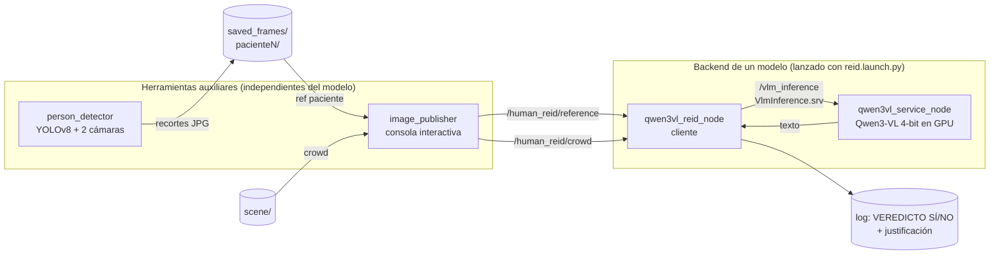

# TFG – Re-identificación de personas con un VLM en ROS 2

Paquete ROS 2 (`human_reid_ros`) que utiliza un modelo visión-lenguaje (VLM) para decidir si una persona de referencia aparece en una escena con varias personas. El backend actual es **Qwen3-VL-8B-Instruct** cuantizado a 4 bits; la arquitectura está pensada para añadir más modelos sin tocar el resto del sistema.

El paquete incluye además herramientas auxiliares independientes del modelo: un **detector de personas** (YOLOv8, dos cámaras) que genera los recortes de referencia, y un **publicador interactivo** que envía referencias y escenas desde disco al sistema ReID.

> Estado: trabajo en curso (TFG). El flujo completo funciona con imágenes de disco. El detector de personas guarda recortes en disco y todavía no publica directamente al nodo ReID.

---

## Índice

1. [Cómo funciona](#cómo-funciona)
2. [Estructura del repositorio](#estructura-del-repositorio)
3. [Nodos, tópicos y servicios](#nodos-tópicos-y-servicios)
4. [Requisitos](#requisitos)
5. [Instalación](#instalación)
6. [Ejecución](#ejecución)
7. [Parámetros](#parámetros)
8. [Añadir otro modelo](#añadir-otro-modelo)
9. [Licencia y autoría](#licencia-y-autoría)

---

## Cómo funciona



1. **`person_detector`** detecta personas con YOLO en dos cámaras sincronizadas. Cuando una persona entra en la zona de interés (ROI) de *ambas* cámaras, guarda un recorte de cada una en `saved_frames/pacienteN/`.
2. **`image_publisher`** (consola interactiva) publica las **referencias** de un paciente (`ref pacienteN`) y las imágenes de la **escena** (`crowd`).
3. **`qwen3vl_reid_node`** agrupa las imágenes por lote, y cuando la escena está completa llama al servicio `/vlm_inference` con *referencias + escena* y un prompt que pide describir a la persona, buscarla en la escena y concluir `VEREDICTO: SÍ` o `VEREDICTO: NO`.
4. **`qwen3vl_service_node`** mantiene el modelo cargado en GPU, atiende las peticiones y devuelve el texto generado.

Separar modelo (servicio) y lógica (cliente) evita recargar el VLM al reiniciar el nodo ReID y permite iterar sobre el prompt sin tocar la GPU.

### Protocolo de lotes entre `image_publisher` y el nodo ReID

No hay interfaces adicionales: la información de lote viaja en `header.frame_id`:

```
frame_id = "<nombre>#<lote>#<n>/<archivo>"
  referencias: <nombre> = paciente      p. ej. "paciente1#1730000000#2/paciente1_cam1.jpg"
  escena:      <nombre> = "scene"       p. ej. "scene#1730000100#2/frame_s33__image_raw.png"
  <lote>: identificador del envío; un lote nuevo descarta el anterior (evita mezclar pacientes)
  <n>:    nº de imágenes del lote; para la escena indica cuándo está completa
```

Si el `frame_id` no sigue este formato (otra fuente de imágenes), se admite igualmente: todo cuenta como un único lote y cada imagen de escena dispara una inferencia (`default_scene_images`).

### Cómo recibe las imágenes el modelo

El servicio concatena `references` + `scene` (en ese orden) y el motor las etiqueta como `Picture 1`, `Picture 2`, … (`add_vision_id=True`). El prompt del cliente usa esas mismas etiquetas para distinguir el grupo de referencia del de escena, y pide citar la imagen como `Picture N` en la respuesta.

---

## Estructura del repositorio

```
TFG_VLM_Human_ReID/
├── CMakeLists.txt            # build ament_cmake: genera el srv e instala módulo, nodos, launch y config
├── package.xml
├── requirements.txt          # dependencias pip (torch, transformers, ultralytics, ...)
├── srv/
│   └── VlmInference.srv      # references[] + scene[] + prompt  ->  success + response
├── launch/
│   └── reid.launch.py        # lanza servicio + nodo ReID del modelo elegido (model:=<modelo>)
├── config/
│   └── qwen3vl.yaml          # parámetros del backend (un YAML por modelo)
├── human_reid_ros/           # módulo Python
│   ├── image_utils.py            # [auxiliar] sensor_msgs/Image <-> numpy (sin cv_bridge)
│   ├── image_publisher.py        # [auxiliar] publica imágenes de disco (consola interactiva)
│   ├── person_detector.py        # [auxiliar] YOLOv8 sobre 2 cámaras, guarda recortes
│   └── qwen3vl/                  # backend Qwen3-VL (autocontenido)
│       ├── qwen3vl_engine.py         # carga e inferencia (4-bit NF4)
│       ├── qwen3vl_service_node.py   # servidor del servicio /vlm_inference
│       └── qwen3vl_reid_node.py      # cliente: referencias + escena -> SÍ/NO
├── saved_frames/             # (datos) recortes por paciente: pacienteN/pacienteN_cam{1,2}.jpg
└── scene/                    # (datos) imágenes de la escena a publicar
```

`image_utils`, `image_publisher` y `person_detector` no dependen de ningún modelo concreto; cada backend vive en su propio subpaquete.

---

## Nodos, tópicos y servicios

| Ejecutable | Función | Publica | Suscribe | Servicio |
|---|---|---|---|---|
| `qwen3vl_service_node.py` | Servidor VLM | – | – | **ofrece** `/vlm_inference` |
| `qwen3vl_reid_node.py` | Cliente ReID | – | `/human_reid/reference`, `/human_reid/crowd` | **usa** `/vlm_inference` |
| `image_publisher.py` | Fuente de imágenes (comandos `list`, `ref`, `crowd`, `exit`) | `/human_reid/reference`, `/human_reid/crowd` | – | – |
| `person_detector.py` | Detector YOLO con 2 cámaras | `/person_detector/cam1/debug`, `/person_detector/cam2/debug` (solo si hay suscriptores) | `/oak/rgb/image_raw`, `/image_raw` | – |

El nodo ReID solo se suscribe a los tópicos **después** de que el servicio esté disponible; por eso `image_publisher` espera a que haya un suscriptor antes de publicar.

**Interfaz `human_reid_ros/srv/VlmInference`**

```
# Request
sensor_msgs/Image[] references   # recortes de la persona objetivo
sensor_msgs/Image[] scene        # vistas de la escena donde buscarla
string prompt
---
# Response
bool success
string response                  # texto del modelo, o mensaje de error si success == false
```

El servicio rechaza peticiones sin al menos una imagen de referencia y una de escena. Encodings de imagen soportados: `rgb8`, `bgr8`, `rgba8`, `bgra8`, `mono8`.

---

## Requisitos

- Ubuntu con **ROS 2** (Jazzy) y `colcon`.
- GPU NVIDIA con CUDA. El modelo 8B en 4 bits necesita bastante VRAM porque cada imagen consume muchos tokens visuales; reduce `max_image_side` o el número de imágenes si te quedas sin memoria.
- Espacio en disco para los pesos (~17 GB de descarga la primera vez) en `cache_dir` (por defecto `/opt/data`).
- Cámaras (solo para `person_detector`): una OAK (`/oak/rgb/image_raw`) y una cámara USB (`/image_raw`).
- Python: `transformers>=4.57.0` (primera versión con Qwen3-VL) y `numpy<2`. Ver `requirements.txt`.

---

## Instalación

```bash
# 1. Clonar dentro de un workspace de ROS 2
mkdir -p ~/ros2_ws/src && cd ~/ros2_ws/src
git clone https://github.com/Yigantopitekus/TFG_VLM_Human_ReID.git

# 2. Dependencias de ROS
cd ~/ros2_ws
source /opt/ros/<distro>/setup.bash
rosdep install --from-paths src --ignore-src -r -y

# 3. Dependencias Python (ver nota sobre entornos más abajo)
pip install -r src/TFG_VLM_Human_ReID/requirements.txt

# 4. Compilar (con el Python del sistema, sin conda/venv activo)
colcon build --packages-select human_reid_ros --symlink-install
source install/setup.bash
```

**Notas importantes**

- **Permisos de ejecución.** Todos los nodos deben ser ejecutables en el repositorio:
  ```bash
  chmod +x src/TFG_VLM_Human_ReID/human_reid_ros/qwen3vl/*_node.py \
           src/TFG_VLM_Human_ReID/human_reid_ros/image_publisher.py \
           src/TFG_VLM_Human_ReID/human_reid_ros/person_detector.py
  ```
  Para que Git lo recuerde: `git update-index --chmod=+x <fichero>`.
- **Entornos virtuales.** Los scripts usan `#!/usr/bin/env python3`. Si usas venv, créalo con `python3 -m venv --system-site-packages .venv` para que siga viendo `rclpy`, y actívalo **al ejecutar** (no al compilar). Con conda, compila siempre con `conda deactivate`.
- **Cada vez que cambies el `.srv`** (o añadas ficheros nuevos), recompila y vuelve a hacer `source install/setup.bash` en *todas* las terminales.
- `numpy<2` es obligatorio mientras `cv_bridge` y las interfaces ROS estén compiladas contra numpy 1.x.

Verifica la instalación:

```bash
ros2 pkg executables human_reid_ros
# human_reid_ros image_publisher.py
# human_reid_ros person_detector.py
# human_reid_ros qwen3vl_reid_node.py
# human_reid_ros qwen3vl_service_node.py

ros2 interface show human_reid_ros/srv/VlmInference
ros2 launch human_reid_ros reid.launch.py --show-args
```

---

## Ejecución

### 1. Pipeline ReID (VLM)

El launcher arranca el **servicio** y el **nodo ReID** del modelo elegido (por defecto `qwen3vl`). `image_publisher` se lanza **aparte**: es una consola interactiva (lee comandos por teclado, y `ros2 launch` no reenvía stdin) y así su salida no se mezcla con la del modelo.

```bash
# Terminal 1 – servicio + nodo ReID (la primera vez descarga los pesos)
ros2 launch human_reid_ros reid.launch.py

# Variantes
ros2 launch human_reid_ros reid.launch.py model:=qwen3vl model_id:=Qwen/Qwen3-VL-4B-Instruct
ros2 launch human_reid_ros reid.launch.py params_file:=/ruta/mis_params.yaml

# Terminal 2 – publicador interactivo de imágenes
ros2 run human_reid_ros image_publisher.py --ros-args \
  -p reference_dir:=$HOME/ros2_ws/src/TFG_VLM_Human_ReID/saved_frames \
  -p crowd_image_path:=$HOME/ros2_ws/src/TFG_VLM_Human_ReID/scene
```

Mientras el modelo carga, el nodo ReID avisa cada 2 s de que el servicio aún no está disponible; es normal. Si cualquiera de los dos nodos termina (p. ej. por falta de VRAM), el launcher apaga el otro.

**Comandos de `image_publisher`:**

| Comando | Acción |
|---|---|
| `list` | Lista los pacientes (subcarpetas de `reference_dir`) y su nº de imágenes |
| `ref <paciente> [fotos...]` | Publica las referencias de un paciente (todas, o solo las indicadas, con o sin extensión) |
| `crowd [fotos...]` | Publica la escena (todas las imágenes de `crowd_image_path`, o solo las indicadas) y dispara la inferencia |
| `exit` | Sale |

Flujo típico: `ref paciente1` → `crowd` → la respuesta aparece en el log de `qwen3vl_reid_node`:

```
ReID [paciente1]:
1. ...
2. ...
VEREDICTO: SÍ — aparece en Picture 4, a la derecha ...
```

Cada envío de `ref` sustituye al anterior, y el nodo conserva como máximo `max_references` imágenes por paciente (las últimas).

<details>
<summary>Lanzar los nodos por separado (depuración)</summary>

```bash
PARAMS=$(ros2 pkg prefix human_reid_ros)/share/human_reid_ros/config/qwen3vl.yaml
ros2 run human_reid_ros qwen3vl_service_node.py --ros-args --params-file $PARAMS
ros2 run human_reid_ros qwen3vl_reid_node.py    --ros-args --params-file $PARAMS
```
</details>

### 2. Detector de personas (YOLO)

```bash
ros2 run human_reid_ros person_detector.py
```

Suscrito a `/oak/rgb/image_raw` y `/image_raw`, sincroniza ambos flujos (tolerancia de 0,1 s). Cuando hay una persona en la ROI de **ambas** cámaras y no la había en el frame anterior, guarda un recorte por cámara:

```
saved_frames/pacienteN/pacienteN_cam1.jpg
saved_frames/pacienteN/pacienteN_cam2.jpg
```

- Si hay varias personas en la ROI, se recorta la de mayor confianza.
- La numeración continúa tras reiniciar el nodo (no sobrescribe pacientes anteriores).
- **ROI cam1 (OAK):** franja derecha de la imagen (x ≥ 0,70). **ROI cam2:** cuadrado centrado de lado `cam2_square_frac` × alto. Una persona está "en ROI" si el centroide de su caja cae dentro. Ambas ROI están fijadas en el código.
- Para ver las detecciones, abre `rqt_image_view` en `/person_detector/cam1/debug` o `/person_detector/cam2/debug` (solo se dibuja si hay suscriptores): verde = en ROI, rojo = fuera.
- Descarga `yolov8n.pt` la primera vez, en el directorio desde el que se lanza.

Los recortes de `saved_frames/` son las referencias que luego se publican con `image_publisher` (`ref pacienteN`).

---

## Parámetros

Los valores por defecto del launcher están en `config/qwen3vl.yaml`. Para cambiarlos sin editar el repo, copia el YAML y pásalo con `params_file:=...`; `model_id:=` sobrescribe solo el modelo. Con `ros2 run` también sirve `--ros-args -p nombre:=valor`.

| Nodo | Parámetro | Defecto | Descripción |
|---|---|---|---|
| `qwen3vl_service_node` | `model_id` | `Qwen/Qwen3-VL-8B-Instruct` | Modelo de Hugging Face |
| | `cache_dir` | `/opt/data` | Carpeta de pesos |
| | `max_new_tokens` | `512` | Longitud máxima de la respuesta (si es corta, el veredicto puede cortarse) |
| | `max_image_side` | `1280` | Presupuesto de píxeles por imagen: `max_image_side²` (acota VRAM/tiempo) |
| `qwen3vl_reid_node` | `reference_topic` | `/human_reid/reference` | Tópico de referencias |
| | `query_topic` | `/human_reid/crowd` | Tópico de escena |
| | `max_references` | `2` | Nº máximo de referencias almacenadas |
| | `default_scene_images` | `1` | Imágenes de escena esperadas si el publicador no lo indica |
| `image_publisher` | `reference_dir` | ruta local del autor | Carpeta base con una subcarpeta por paciente |
| | `crowd_image_path` | ruta local del autor | Carpeta de escena (o una sola imagen) |
| | `subscriber_timeout_sec` | `15.0` | Espera máxima de un suscriptor |
| `person_detector` | `save_dir` | `saved_frames` | Carpeta de salida (relativa a donde se lanza) |
| | `conf_threshold` | `0.5` | Confianza mínima de YOLO (estricta: `>` umbral) |
| | `crop_margin` | `0.0` | Margen extra alrededor de la caja, como fracción de su tamaño |
| | `cam2_square_frac` | `0.25` | Lado del cuadrado ROI de cam2, fracción de la altura |
| | `debug_topic_cam1` / `debug_topic_cam2` | `/person_detector/camN/debug` | Tópicos del vídeo anotado |

> Los valores por defecto de `reference_dir` y `crowd_image_path` apuntan a rutas del equipo del autor: pásalos siempre con `--ros-args -p`.

---

## Añadir otro modelo

El launcher descubre los modelos a partir de `config/<modelo>.yaml` y busca los ejecutables `<modelo>_service_node.py` y `<modelo>_reid_node.py`. Para añadir uno (`mimodelo`):

1. Crear `human_reid_ros/mimodelo/` (con `__init__.py`) con:
   - `mimodelo_engine.py`: carga e inferencia.
   - `mimodelo_service_node.py`: ofrece `/vlm_inference` con `VlmInference.srv`.
   - `mimodelo_reid_node.py`: cliente ReID (puede partir del de Qwen, ajustando el prompt al modelo).
2. Crear `config/mimodelo.yaml` con las claves `mimodelo_service_node` y `mimodelo_reid_node`.
3. Añadir los dos nodos al `install(PROGRAMS ...)` del `CMakeLists.txt`, darles `chmod +x` y recompilar.
4. Lanzarlo: `ros2 launch human_reid_ros reid.launch.py model:=mimodelo`.

Notas de diseño:

- Todos los modelos usan el mismo nombre de servicio (`/vlm_inference`), así que **se lanza un modelo cada vez**.
- Los ejecutables llevan el prefijo del modelo porque todos se instalan planos en `lib/human_reid_ros/`.
- Los auxiliares (`image_publisher`, `person_detector`, `image_utils`) no hay que tocarlos: hablan con cualquier backend a través de los tópicos y el `.srv`.

---

## Solución de problemas

**`ros2 run human_reid_ros person_detector.py` → "No executable found"**
1. Comprueba el bit de ejecución del fichero fuente: `ls -l human_reid_ros/person_detector.py` debe mostrar `-rwxr-xr-x`. Con `--symlink-install`, el ejecutable instalado es un enlace al fichero original y `ros2 run` solo lista ficheros ejecutables.
2. Comprueba lo instalado: `ls -l install/human_reid_ros/lib/human_reid_ros/`.
3. Recompila limpio: `rm -rf build/human_reid_ros install/human_reid_ros && colcon build --packages-select human_reid_ros --symlink-install` y vuelve a hacer `source install/setup.bash`.
4. Recuerda el nombre completo: el ejecutable se llama `person_detector.py` (con extensión).

**`launch` → "Modelo 'x' desconocido"**
Solo hay modelos para los que exista `config/<modelo>.yaml` *instalado*. Tras añadir un YAML, recompila y haz `source install/setup.bash`.

**`'Qwen3VLEngine' object has no attribute 'infer'`**
Casi siempre es una copia instalada desactualizada (compilaste sin `--symlink-install` y editaste después) o un problema de indentación del fichero. Recompila y comprueba:
```bash
python3 -c "from human_reid_ros.qwen3vl.qwen3vl_engine import Qwen3VLEngine as E; print(hasattr(E,'infer'))"
```

**`AttributeError` al asignar `req.references` / `ImportError: cannot import name 'VlmInference'`**
El nodo está viendo una definición antigua del `.srv` o no se ha compilado. Recompila, `source install/setup.bash` en todas las terminales y comprueba con `ros2 interface show human_reid_ros/srv/VlmInference`.

**`image_publisher`: "Ningún suscriptor en /human_reid/..."**
El nodo ReID solo se suscribe cuando el servicio del modelo ya está activo. Espera a ver `Nodo ReID listo` en el log del launcher (la primera ejecución puede tardar por la descarga de pesos) y reintenta.

**`ModuleNotFoundError: ultralytics` / `bitsandbytes`**
Instala `requirements.txt` en el mismo entorno de Python con el que se lanza el nodo.

**`person_detector` no recibe frames**
Los drivers de cámara suelen publicar con QoS `BEST_EFFORT`; un suscriptor `RELIABLE` no conecta. Comprueba con `ros2 topic info -v /image_raw`. Comprueba también que ambas cámaras tienen `header.stamp` coherentes (la sincronización admite 0,1 s de diferencia).

**`CUDA out of memory` o inferencia muy lenta**
Las fotos de alta resolución generan miles de tokens visuales cada una. Baja `max_image_side` (p. ej. a 768–1024), reduce `max_references` o publica menos imágenes de escena.

**La respuesta se corta antes del `VEREDICTO`**
Sube `max_new_tokens` en `config/qwen3vl.yaml`.

---
# Ejemplo

## Fotos de referencia


## Fotos de la sala entera


## Output
```bash
[qwen3vl_service_node.py-1] [INFO] [1794423385.802342908] [qwen3vl_service_node]: Servidor VLM activo (servicio 'vlm_inference').
[qwen3vl_reid_node.py-2] [INFO] [1794423385.805235218] [qwen3vl_reid_node]: ¡Servicio enlazado correctamente!
[qwen3vl_reid_node.py-2] [INFO] [1794423385.811137073] [qwen3vl_reid_node]: Nodo ReID listo. Carga imágenes y lanza la consulta con 'ask'.

[qwen3vl_reid_node.py-2] [INFO] [1794423402.426789630] [qwen3vl_reid_node]: Referencias de 'paciente13': 1
[qwen3vl_reid_node.py-2] [INFO] [1794423402.922519897] [qwen3vl_reid_node]: Referencias de 'paciente13': 2
[qwen3vl_reid_node.py-2] [INFO] [1794423405.247988593] [qwen3vl_reid_node]: Escena: 1/2 imágenes cargadas.
[qwen3vl_reid_node.py-2] [INFO] [1794423405.457297748] [qwen3vl_reid_node]: Escena: 2/2 imágenes cargadas.
[qwen3vl_reid_node.py-2] [INFO] [1794423412.106456536] [qwen3vl_reid_node]: Consultando al VLM: paciente 'paciente13' (2 ref.) + escena (2 img.), prompt por defecto...
[qwen3vl_reid_node.py-2] [INFO] [1794423423.195919587] [qwen3vl_reid_node]: ReID [paciente13]:
[qwen3vl_reid_node.py-2] **Veredicto: SI**
[qwen3vl_reid_node.py-2] 
[qwen3vl_reid_node.py-2] **Justificación:**
[qwen3vl_reid_node.py-2] La persona objetivo en las imágenes de referencia (Picture 1 y 2) es un hombre visto de espaldas, con cabello corto y oscuro, vistiendo una camisa de color rosa intenso (o coral) y pantalones blancos o de color claro. En Picture 1, se observa que está de pie, ligeramente inclinado hacia adelante, frente a una mesa o consola con un control rojo. En Picture 2, la postura es más erguida, y se ve que lleva una camisa de manga larga con cuello redondo y pantalones de corte recto.
[qwen3vl_reid_node.py-2] 
[qwen3vl_reid_node.py-2] Al analizar las imágenes de escena (Picture 3 y 4), se observa que en ambas, el mismo hombre (con la misma camisa rosa y pantalones claros) está sentado en el sofá, a la derecha del centro, junto a otros jóvenes. En Picture 4, su posición es claramente identificable: está sentado en el sofá, al lado de una mujer con camisa beige y una mujer con camisa azul, y frente a una televisión. Su postura es sentada, en contraste con las imágenes de referencia donde está de pie, pero el vestuario y la apariencia física coinciden exactamente.
[qwen3vl_reid_node.py-2] 
[qwen3vl_reid_node.py-2] Aunque el contexto cambia (de pie frente a una consola vs. sentado en un sofá), las características visuales (vestuario, peinado, postura general) son consistentes. La persona objetivo aparece en la escena en Picture 4 (y también en Picture 3, aunque menos visible). Por lo tanto, se confirma su presencia en la escena.
[qwen3vl_reid_node.py-2] 
[qwen3vl_reid_node.py-2] **Posición en la sala (2D):** En Picture 4, la persona está ubicada en la parte derecha del sofá, en la posición de la cuarta persona contando desde la izquierda (o la tercera contando desde la derecha), sentada. En Picture 3, está en la misma posición, aunque la imagen es más borrosa.
[qwen3vl_reid_node.py-2] 
[qwen3vl_reid_node.py-2] **Conclusión:** La persona objetivo está presente en la escena, en la posición descrita. Veredicto: SI.


```
## Licencia y autoría

Licencia: Apache-2.0 (añade un fichero `LICENSE` al repositorio).

Autor: Roberto Donate Lario — TFG, URJC / Ingeniería Robótica Software.
Modelo utilizado: [Qwen3-VL](https://huggingface.co/Qwen) (Alibaba Cloud). Detección: [Ultralytics YOLOv8](https://github.com/ultralytics/ultralytics).
